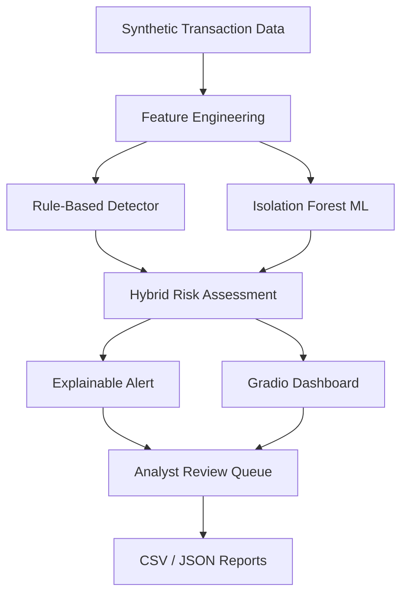

# Architecture

1. Synthetic transaction generator
2. Feature engineering: amount ratio, recent transaction count,
   and new-payee indicator
3. Transparent rule-based detector
4. Isolation Forest anomaly detector
5. Risk assessment and human-readable explanations
6. Gradio interface and analyst review queue
7. Held-out evaluation and CSV/JSON reports

## Data flow
Synthetic events -> Feature engineering -> Rules + ML
-> Risk explanation -> Human review -> Evaluation report

No live UPI connection, payment execution, or automatic blocking exists.

## System Architecture Diagram

## Core Features

- Transparent rules-based risk assessment
- Isolation Forest anomaly detection
- Human-readable reasons for alerts
- Analyst review workflow
- Evaluation metrics and downloadable reports

## Data and Safety

This prototype uses synthetic transaction data. It does not connect
to real UPI accounts, initiate payments, or automatically block
transactions. An anomaly is not proof of fraud.
